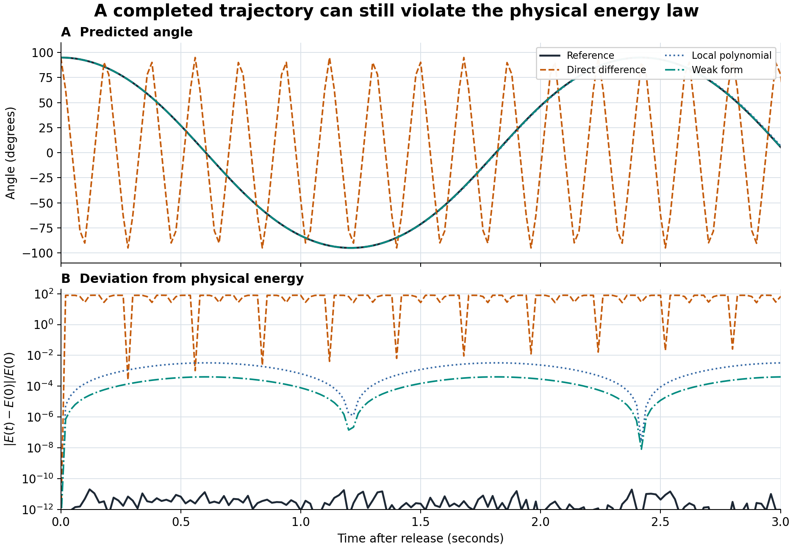
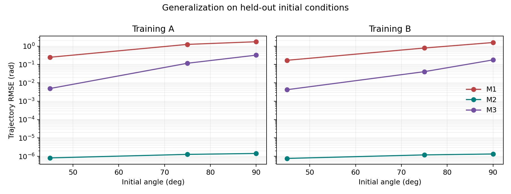
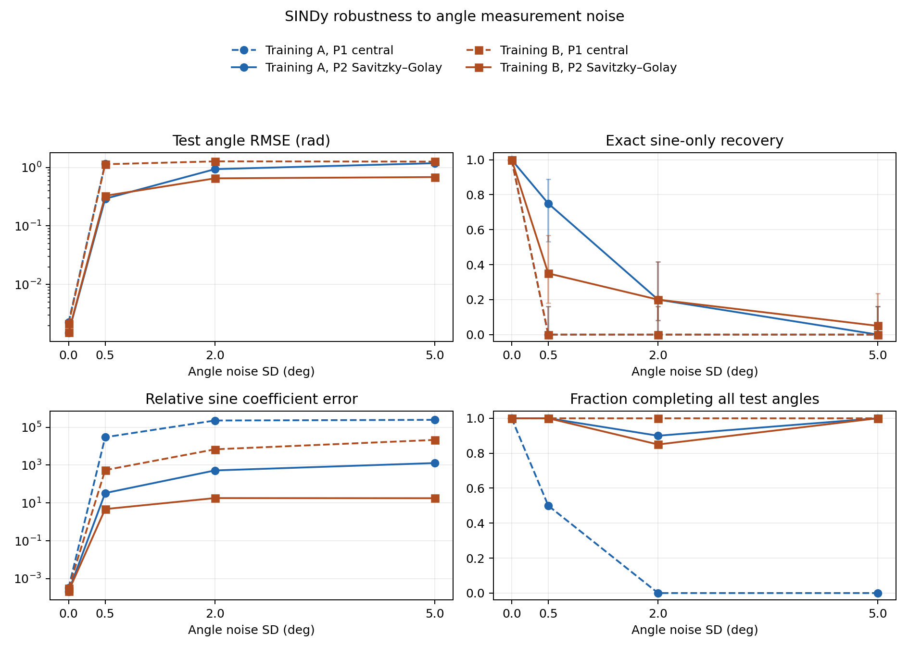
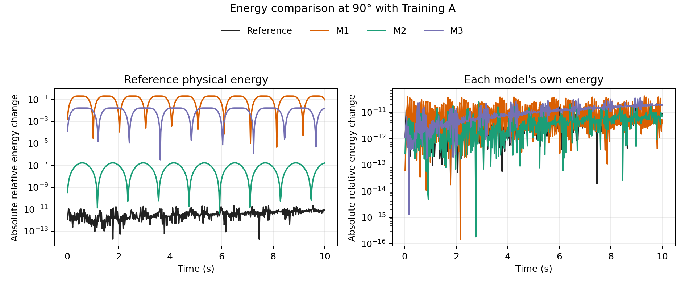
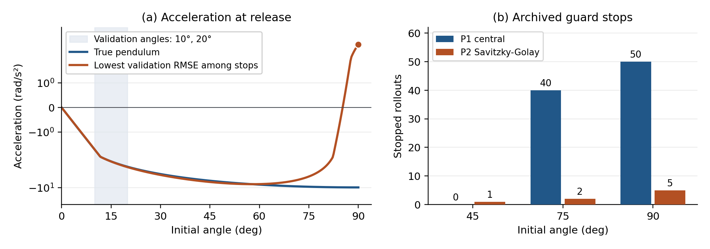
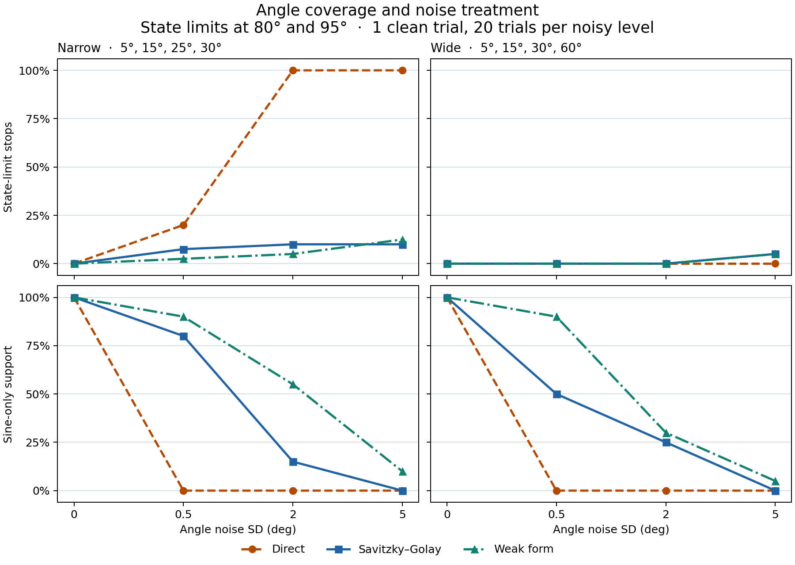
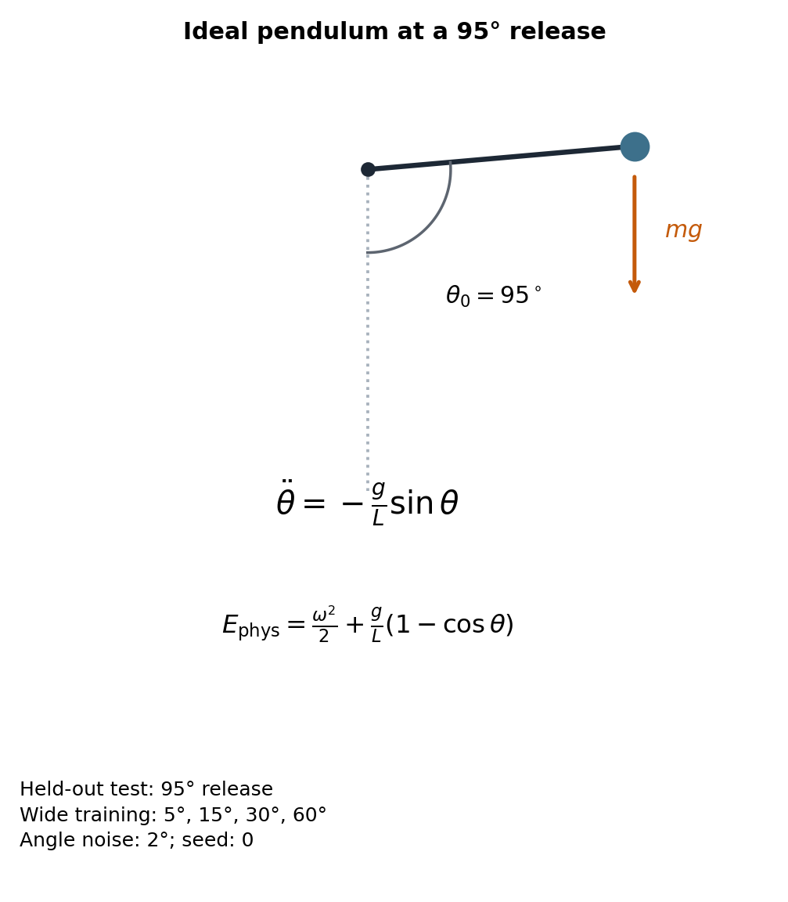

# Learning Nonlinear Pendulum Dynamics from Noisy Data

Can a model learned from noisy pendulum angles predict a release angle it has not seen and still obey the pendulum's energy law? I studied this with an ideal, undamped pendulum, where the correct force and energy are known. I began with clean-data baselines, then tested noisy equation fitting, proved the energy law in Lean 4, investigated failed predictions, and compared three fitting methods under a fixed training budget. A completed prediction can still have large physical-energy drift.

The observations are simulated. The candidate equation library already contains the sine term. The project tests whether a method selects that term and uses it well; it does not claim to discover the sine function without prior knowledge.

- [v1 release: Phases 1–4](https://github.com/crustypan/pendulum-dynamics-from-noisy-data/releases/tag/v1) · [Phase 5 results](phase5/RESULTS.md)
- [Six-page research report (v1)](report/pdf/research_report.pdf) · [One-page Research Highlight (v1)](report/pdf/research_highlight.pdf)
- [Data and proof guide](docs/artifact_index.md) · [Figure index](report/README.md#figure-and-evidence-index)

The example below uses four training releases at 5°, 15°, 30°, and 60°. It tests a new 95° release with 2° angle noise (seed 0). All three fitted trajectories complete, but the direct-difference fit has large physical-energy drift. The plot shows the first 3 seconds; the [10-second plot](phase5/results/main/figures/heldout_example.png) and [metrics](phase5/results/main/test_metrics.csv) are archived.

[](figures/overview/heldout_95deg.png)

*Figure 1. A completed prediction is not necessarily a physical prediction. [Plot source](figures/overview/make_overview.py).*

## Results at a glance

Click a figure for its full-size PNG. Source data and scripts are linked in the sections below.

### Phase 1. Predicting unseen angles

[](figures/baseline/test_rmse.png)

The fitted sine model averages about 1.1–1.2 × 10⁻⁶ rad in held-out angle RMSE. The linear and cubic fits have larger errors at higher release angles.

### Phase 2. Recovering an equation from noisy angles

[](figures/noise_sindy/noise_robustness.png)

Of 120 noisy fits per method, Savitzky–Golay recovered sine-only support in 31; central differences recovered it in 0. The test RMSE panel includes only seeds that completed all three test angles.

### Phase 3. Comparing fitted and physical energy

[](figures/energy_drift/baseline_conservation.png)

At 90° with Training A, the linear model's own energy changes by at most 4.16 × 10⁻¹¹ of its initial value in the sampled trajectory. The corresponding physical energy change is 20.0%. See the [Lean energy proofs](lean/Pendulum/Energy.lean) and [SINDy drift comparison](figures/energy_drift/physical_energy_drift.png).

### Phase 4. Diagnosing failed SINDy predictions

[](figures/failure_diagnostics/failure_mechanisms.png)

Both solver settings reproduced the 100 rad/s speed limit in all 98 stopped rollouts; 97 began at 75° or 90°. The left panel shows a fit that predicts outward acceleration at 90° despite low validation error.

### Phase 5. Training-angle coverage and weak-form SINDy

Each design uses four training trajectories. The narrow design uses 5°, 15°, 25° and 30°. The wide design replaces 25° with 60°. Model selection uses separate 10° and 20° validation runs. The new 50°, 80° and 95° releases are evaluated after selection is frozen.

The table pools the three noisy conditions at the primary 80° and 95° releases, outside both training ranges.

| Method | State-limit stops, narrow | State-limit stops, wide | Sine-only models, narrow | Sine-only models, wide |
| --- | ---: | ---: | ---: | ---: |
| Direct differences | 88/120 | 0/120 | 0/60 | 0/60 |
| Savitzky–Golay | 11/120 | 2/120 | 19/60 | 15/60 |
| Weak form | 8/120 | 2/120 | 31/60 | 25/60 |

[](phase5/results/main/figures/benchmark_outcomes.png)

Among matched trajectories that both methods completed, weak-form SINDy reduced the mean angle RMSE relative to Savitzky–Golay by 0.325 rad in the narrow design and 0.170 rad in the wide design. The wide direct-difference fits completed all 120 primary tests, with a median maximum physical energy deviation of 39.24 times the initial energy.

[Paired-effects figure with 95% bootstrap intervals](phase5/results/main/figures/paired_effects.png)

The complete archive includes all 1,098 test outcomes and 732 tighter-tolerance checks. [Phase 5 report](phase5/RESULTS.md) · [95° trajectory and energy example](phase5/results/main/figures/heldout_example.png) · [Paired comparison table](phase5/results/main/paired_contrasts.csv)

## Physical model

I use a point mass $m$ on a massless rigid rod of length $L=1\,\mathrm{m}$. The pendulum moves in one plane with no friction or external drive. Let $\theta$ be the angle from the downward vertical and $\omega=\dot\theta$. Gravity has tangential torque $\tau_g=-mgL\sin\theta$. Since the moment of inertia is $I=mL^2$,

$$
I\dot\omega=\tau_g,\qquad
\dot\theta=\omega,\qquad
\dot\omega=-k\sin\theta,\qquad k=\frac{g}{L}=9.81\,\mathrm{s}^{-2}.
$$

[](figures/overview/pendulum_reference.png)

*Figure 2. Sign convention and physical reference. The 95° release is a Phase 5 test angle, not a training angle.*

The sine comes from the direction of gravity relative to the rod. Replacing $\sin\theta$ with $\theta$ is a small-angle approximation, so I expected it to fail at large releases. The cubic Taylor approximation, $\sin\theta\approx\theta-\theta^3/6$, gives a second local alternative. These physical approximations determined the three model families in Phase 1; their coefficients were then fitted from angle data.

Kinetic energy is $mL^2\omega^2/2$ and potential energy above the hanging position is $mgL(1-\cos\theta)$. Dividing by $mL^2$ gives physical energy per unit moment of inertia:

$$
E_{\mathrm{phys}}(\theta,\omega)=\frac{\omega^2}{2}+k(1-\cos\theta).
$$

For a candidate acceleration $\dot\omega=f(\theta,\omega)$, the chain rule gives

$$
\frac{dE_{\mathrm{phys}}}{dt}=\omega\bigl[f(\theta,\omega)+k\sin\theta\bigr].
$$

This rate is zero for the ideal force $f=-k\sin\theta$. I use the same physical energy to check every fitted model, even when a model has a different energy of its own.

## How the study developed

### Phase 1 — Clean-data baseline

I first asked how much the force law matters when measurement noise is absent. The three chosen acceleration families were $-a\theta$, $-a\sin\theta$, and $-a\theta-b\theta^3$. A five-point central difference estimated acceleration from sampled angles, and least squares fitted the coefficients. Each trajectory started from rest, ran for 10 seconds, and was sampled every 0.02 seconds. Training A used 5°, 15°, and 30° releases; Training B added 60°. Validation used 10° and 20°; tests used 45°, 75°, and 90°.

At the 90° test under Training A, the sine fit had angle RMSE $1.43\times10^{-6}\,\mathrm{rad}$, compared with $1.73\,\mathrm{rad}$ for the linear fit and $0.322\,\mathrm{rad}$ for the cubic fit. This agrees with the physical expectation: a local approximation is unreliable far from the hanging position. Training B changed both the number of trajectories and the angular range. I could not attribute any improvement to coverage alone, which motivated the fixed-budget design in Phase 5. [Saved coefficients and errors](results/baseline/metrics.csv)

### Phase 2 — Learning from noisy angles

I then added independent Gaussian noise to each measured angle, with standard deviation 0°, 0.5°, 2°, or 5°. There was one clean run and 20 noise realizations at each positive level. The same noisy observations were used when comparing derivative estimators. Model settings were selected on the 10° and 20° validation releases before testing the frozen equations at 45°, 75°, and 90°.

Sparse Identification of Nonlinear Dynamics (SINDy) fitted coefficients from the supplied library $\{\theta,\theta^3,\sin\theta,\omega\}$:

$$
\dot\omega=c_1\theta+c_2\theta^3+c_3\sin\theta+c_4\omega.
$$

Direct differences estimate acceleration by dividing a second angle difference by the squared 0.02-second interval. This greatly magnifies noise: at 2° angle noise, the estimated acceleration-noise scale is about $214\,\mathrm{rad/s^2}$, while the reference acceleration is at most about $10\,\mathrm{rad/s^2}$. Savitzky–Golay smoothing instead differentiates a polynomial fitted in a local time window. Across 120 noisy fits per method, smoothing selected only the sine term in 31; direct differences did so in none. Of 732 held-out trajectories, 634 completed and 98 hit a predefined state limit. Stopped paths are reported separately from angle-error summaries. [Method and noise breakdown](docs/phase2_results.md)

### Phase 3 — Proving and measuring energy change

Lean 4 and Mathlib check the energy-rate formula above under explicit differentiability and differential-equation assumptions. Substituting the ideal force gives zero rate; a separate interval theorem proves conservation along an exact solution. For a fitted four-term law, Lean gives

$$
\frac{dE_{\mathrm{phys}}}{dt}
=\omega\bigl[c_1\theta+c_2\theta^3+(c_3+k)\sin\theta+c_4\omega\bigr].
$$

The rate is zero at every real state exactly when $c_1=c_2=c_4=0$ and $c_3=-k$. One indexed theorem applies this result to the 244 archived Phase 2 coefficient vectors, represented as exact rationals. The proof does not certify that a fitted law describes the real pendulum or that a numerical solver is exact.

A model can conserve its own energy and still violate the reference energy law. For this fitted library, its own energy satisfies

$$
E_{\mathrm{fit}}=\frac{\omega^2}{2}-\frac{c_1\theta^2}{2}-\frac{c_2\theta^4}{4}+c_3(\cos\theta-1),
\qquad \frac{dE_{\mathrm{fit}}}{dt}=c_4\omega^2.
$$

Thus $c_4=0$ gives conservation of $E_{\mathrm{fit}}$, even if the model has the wrong physical potential. For example, the Phase 1 linear fit at 90° changes its own sampled energy by at most $4.16\times10^{-11}$ of its initial value, while its sampled physical energy changes by about 20.0%. I report numerical drift over the saved times as

$$
D_E=\frac{\max_i|E_{\mathrm{phys}}(t_i)-E_{\mathrm{phys}}(0)|}{E_{\mathrm{phys}}(0)}.
$$

This sampled diagnostic is not a bound for every time. [Lean source](lean/Pendulum/Energy.lean) · [Proof and numerical audit](docs/phase3_results.md)

### Phase 4 — Investigating stopped predictions

The 98 stopped Phase 2 tests might have been caused by the numerical solver rather than the fitted equations. I kept the equations fixed and replayed every stopped test with tighter tolerances. All 98 again reached the $100\,\mathrm{rad/s}$ angular-speed guard; 97 started at 75° or 90°. The guard is a numerical stop rule, not a physical speed limit. By comparison, an ideal pendulum released from rest at or below 90° has maximum speed $\sqrt{2k}\approx4.43\,\mathrm{rad/s}$.

One frozen fit had only about $0.0407\,\mathrm{rad}$ validation error but predicted outward acceleration of $+4.08\,\mathrm{rad/s^2}$ at 90°. The reference predicts $-9.81\,\mathrm{rad/s^2}$. Near small angles, $\theta$ and $\sin\theta$ are similar, so large fitted coefficients can cancel on validation data and separate at a large test angle. The energy-rate formula then shows how the wrong force changes physical energy. This gave a physical explanation for a failure that angle error on the validation set did not reveal. [Frozen-model analysis](docs/phase4_failure_analysis.md)

### Phase 5 — Testing coverage with a fixed data budget

Phase 1 could not separate training coverage from training count. I therefore used four trajectories in each Phase 5 design: 5°, 15°, 25°, 30° for narrow coverage and 5°, 15°, 30°, 60° for wide coverage. Validation remained at 10° and 20°. The new tests were 50°, 80°, and 95°, with 80° and 95° as the primary comparison. The methods used matched noise realizations and the same number of observed samples.

I compared direct differences, Savitzky–Golay differentiation, and weak-form SINDy. In the weak form, smooth test functions are integrated against the equation; integration by parts transfers time derivatives from noisy measurements to known test functions. All methods used the same four-term candidate library and validation-based selection. The study selected 366 models and planned 1,098 held-out trajectories. Of these, 986 completed and 112 hit a state limit.

Wide coverage removed all 88 direct-difference stops seen in the narrow design's 120 primary tests, but the wide direct fits had a median maximum physical-energy deviation of 39.24 times the initial energy among completed primary tests. On paired trajectories that both methods completed, weak-form SINDy reduced mean angle RMSE relative to Savitzky–Golay by $0.325\,\mathrm{rad}$ for narrow coverage and $0.170\,\mathrm{rad}$ for wide coverage. At 5° noise, sine-only recovery remained low even for weak-form fitting (2/20 narrow and 1/20 wide). All 732 primary tests kept the same completion status when replayed at tighter solver tolerances. [Protocol](phase5/PROTOCOL.md) · [Full tables and intervals](phase5/RESULTS.md)

## Interpretation and limits

The five phases answer different parts of the same question. The clean-data test shows why the sine force matters at large angles. The noisy-data test shows how second differentiation can damage equation selection. The Lean proof states the energy law precisely, and the frozen-model replay links wrong extrapolated force to stopped predictions. Phase 5 controls the training budget and shows that fewer stops do not guarantee a physically sound equation.

I report equation support, trajectory error and completion, and physical-energy deviation separately. This is a synthetic benchmark with known initial conditions and a candidate library that includes $\sin\theta$. It has not been tested on a real sensor. Different sampling rates, noise structures, and independent high-angle validation are useful next tests. The [six-page report](report/pdf/research_report.pdf) and [Research Highlight](report/pdf/research_highlight.pdf) cover v1 (Phases 1–4); [Phase 5](phase5/RESULTS.md) is documented separately.

## Repository map

| Path | Purpose |
| --- | --- |
| `phase5/` | Coverage and noise comparison, weak-form implementation, figures, results and verification |
| `configs/baseline.json`, `configs/noise.json`, `configs/energy.json` | Physical reference, data splits, random seeds, fit grid and integration settings |
| `src/pendulum_research/` | Reference simulation, preprocessing, sparse fitting, model evaluation, and energy analysis |
| `scripts/run_baseline.py`, `scripts/run_noise_experiments.py` | Generate Phases 1 and 2, including coefficients, predictions and figures |
| `scripts/run_energy_analysis.py`, `scripts/run_failure_diagnostics.py` | Replay frozen equations for physical energy and guard analysis |
| `scripts/verify_*.py`, `tests/` | Check archived artifacts, mathematical and numerical results, and report builds |
| `lean/Pendulum/Energy.lean`, `lean/Pendulum/FrozenModels.lean` | General energy proofs and their specialization to the frozen coefficient table |
| `lean/Audit.lean`, `lean/lean-toolchain`, `lean/lake-manifest.json` | Theorem dependency audit and exact Lean/Mathlib pins |
| `results/` | Coefficients, traces, metrics, checksums and verification records; see the [data guide](docs/artifact_index.md) |
| `figures/` | Full-size experiment figures and the two overview images; `figures/overview/make_overview.py` regenerates the latter |
| `report/` | Both PDFs, editable Markdown and the reproducible build receipt |
| `docs/` | [Study plan](docs/research_plan.md), [experiment log](docs/experiment_log.md), [research decisions](docs/research_decisions.md), and phase protocols |

## Reproduce the results

Use Python 3.10 with the pinned dependencies. The verified Linux setup uses Bubblewrap and a user systemd session. The runner limits jobs to 50% of one CPU core and 1 GiB of memory. It uses the project for writable files and runs offline, with network access explicitly enabled for dependency setup. The pinned Lean installer is for Linux x86-64. The PDF build uses the Linux Lato and DejaVu fonts.

Run these commands from the repository root. Keep the archived output directories unchanged.

```bash
python3 -B scripts/run_isolated.py -- python3 -I -B -m venv .venv
python3 -B scripts/run_isolated.py --network -- .venv/bin/python -m pip install -r requirements-lock.txt
python3 -B scripts/run_isolated.py --network -- .venv/bin/python -m pip install --no-deps --no-build-isolation -e .
python3 -B scripts/run_isolated.py -- .venv/bin/python scripts/check_isolation.py
python3 -B scripts/run_isolated.py -- .venv/bin/python -m pytest -q
```

### Phase 5 benchmark

Use the Python environment set up above. Run the four stages in order from the repository root. The archived results are in `phase5/results/main/`. Use a new run name under `phase5/results/` to reproduce the experiment.

```bash
run=phase5/results/reproduction
python3 -B phase5/run_isolated.py -- .venv/bin/python -B phase5/experiment.py fit --run-dir "$run"
python3 -B phase5/run_isolated.py -- .venv/bin/python -B phase5/experiment.py evaluate --run-dir "$run"
python3 -B phase5/run_isolated.py -- .venv/bin/python -B phase5/report.py --run-dir "$run"
python3 -B phase5/run_isolated.py -- .venv/bin/python -B phase5/verify.py --run-dir "$run" --replay-trial 21
```

The fit stage freezes the candidate and selected-model records. The evaluation stage verifies that freeze before generating the new test releases. The verification stage checks the saved trajectories and tables and refits one noisy trial. [Phase 5 protocol](phase5/PROTOCOL.md) · [Portable Python setup and artifact index](phase5/README.md)

### Numerical experiments

The examples below write new results under the ignored `.tmp/reproduce/` directory. Use a new output directory on subsequent runs. Phases 3 and 4 intentionally analyze the frozen artifacts included with this repository.

```bash
# Phase 1: noiseless simulation and baselines
python3 -B scripts/run_isolated.py -- .venv/bin/python scripts/run_baseline.py \
  --output .tmp/reproduce/baseline --figures .tmp/reproduce/fig_baseline
python3 -B scripts/run_isolated.py -- .venv/bin/python scripts/verify_saved_run.py \
  --results .tmp/reproduce/baseline

# Phase 2: noisy observations, validation selection and test rollouts
python3 -B scripts/run_isolated.py -- .venv/bin/python scripts/run_noise_experiments.py \
  --output .tmp/reproduce/noise --figures .tmp/reproduce/fig_noise
python3 -B scripts/run_isolated.py -- .venv/bin/python scripts/verify_noise_results.py \
  --results .tmp/reproduce/noise

# Phase 3: physical energy drift and tighter integration
python3 -B scripts/run_isolated.py -- .venv/bin/python scripts/run_energy_analysis.py \
  --output .tmp/reproduce/energy --figures .tmp/reproduce/fig_energy
python3 -B scripts/run_isolated.py -- .venv/bin/python scripts/verify_energy_analysis.py \
  --results .tmp/reproduce/energy

# Phase 4: terminal events from the archived SINDy equations
python3 -B scripts/run_isolated.py -- .venv/bin/python scripts/run_failure_diagnostics.py \
  --output .tmp/reproduce/failures --figures .tmp/reproduce/fig_failures
```

### Lean 4 and Mathlib

The installer verifies the official Lean 4.24.0 release archive and fetches the Mathlib revisions pinned in the Lake manifest. The exact rational coefficients in Lean are checked against the frozen Phase 2 CSV.

```bash
python3 -B scripts/run_lean.py --network -- /usr/bin/python3 -B scripts/install_lean.py
python3 -B scripts/verify_lean.py --output .tmp/reproduce/lean_verification
```

The [saved proof audit](results/lean_verification/verification.json) lists the compiler versions, source hashes, package revisions and theorem dependencies. The formal guarantees apply to exact trajectories satisfying the stated hypotheses. Sampled drift is a numerical diagnostic.

### Overview figures

After installing the pinned Python dependencies above, regenerate Figures 1 and 2 from the archived Phase 5 results:

```bash
python3 -B scripts/run_isolated.py -- .venv/bin/python -B figures/overview/make_overview.py
```

### PDFs and archive verification

```bash
python3 -B scripts/run_isolated.py --network -- .venv/bin/python -m pip install \
  --only-binary=:all: --no-deps --target .tools/report-packages -r requirements-report-lock.txt
python3 -B scripts/run_isolated.py -- .venv/bin/python scripts/build_phase4_reports.py \
  --output .tmp/reproduce/pdf
python3 -B scripts/run_isolated.py -- .venv/bin/python scripts/verify_phase4.py
```

See the [Phase 4 checks](results/phase4_checks) for test, Lean, archive and PDF verification. The dependency installations, compiled Lean cache, virtual environments, and temporary files are excluded from version control.
