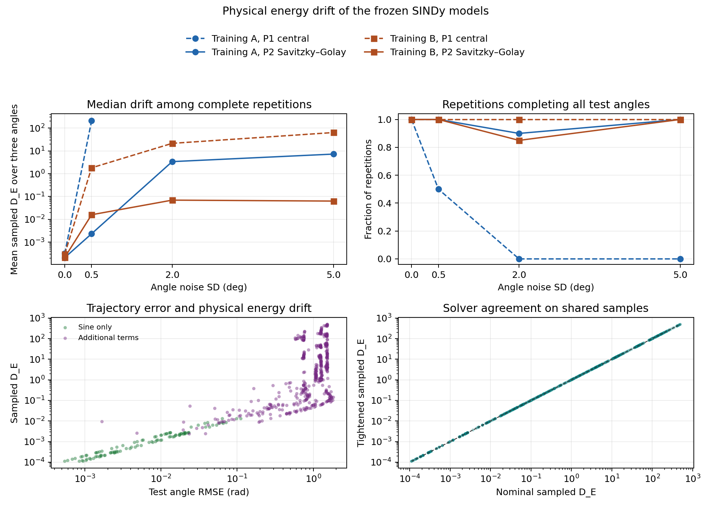
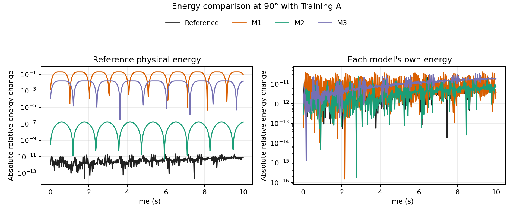

# Phase 3: Pendulum energy and frozen SINDy models

The ideal pendulum's physical energy is constant under the stated dynamics, as checked in Lean. None of the 244 archived SINDy models has the exact reference coefficient tuple. The 634 completed test rollouts show substantially lower sampled physical energy drift for sine-only models than for models with additional terms in this study.

## What Lean proves

For differentiable states with $\dot\theta=\omega$ and $\dot\omega=f(\theta,\omega)$, Lean proves
$$
E_{\rm phys}=\tfrac12\omega^2+k(1-\cos\theta),\qquad
\dot E_{\rm phys}=\omega\bigl[f(\theta,\omega)+k\sin\theta\bigr].
$$
For $f=-k\sin\theta$, the rate is zero. The interval theorem assumes continuity of both state functions on the closed interval and the differential equations in its interior. The mean value theorem then gives equality of the energy at any two times in that interval, including its endpoints.

For a frozen equation $f=c_1\theta+c_2\theta^3+c_3\sin\theta+c_4\omega$, the physical energy rate is
$$
\dot E_{\rm phys}
=\omega\bigl[c_1\theta+c_2\theta^3+(c_3+k)\sin\theta+c_4\omega\bigr].
$$
The fitted model's own potential is $U_{\rm fit}=-c_1\theta^2/2-c_2\theta^4/4-c_3(1-\cos\theta)$. The fitted energy $E_{\rm fit}=\omega^2/2+U_{\rm fit}$ has rate $c_4\omega^2$, so the velocity coefficient controls the direction of its change. Lean also proves that the physical rate vanishes at **every** real state exactly when $(c_1,c_2,c_3,c_4)=(0,0,-k,0)$.

| Result | Lean theorem |
| --- | --- |
| General physical energy rate | `physicalEnergy_hasDerivAt` |
| Linear and sine-only physical rates | `linear_physicalEnergy_hasDerivAt`, `sinusoidal_physicalEnergy_hasDerivAt` |
| True pendulum zero rate and interval conservation | `truePendulum_physicalEnergy_hasDerivAt_zero`, `truePendulum_physicalEnergy_eq_on_Icc` |
| Linear model's own zero rate and interval conservation | `linearEnergy_hasDerivAt_zero`, `linearEnergy_eq_on_Icc` |
| Cubic model's own zero rate | `polynomialEnergy_hasDerivAt_zero` |
| SINDy physical and fitted energy rates | `sindy_physicalEnergy_hasDerivAt`, `sindy_modelEnergy_hasDerivAt` |
| Exact coefficient condition for zero physical rate at all states | `sindyPhysicalRate_zero_everywhere_iff` |
| Number of frozen records and physical rate for every record | `FrozenModels.coefficient_count`, `FrozenModels.physicalEnergy_hasDerivAt_for_model` |

[Energy.lean](../lean/Pendulum/Energy.lean) defines and proves the general results. [FrozenModels.lean](../lean/Pendulum/FrozenModels.lean) contains the ordered coefficient table and instantiates the energy-rate theorem at $k=981/100$ for any index in the table. The [exporter](../scripts/generate_frozen_lean.py) encodes the archived decimal coefficients as exact rational reals and checks the result against the frozen CSV. The [audit](../results/lean_verification/axioms.log) checks all 13 public theorems. Its allowed dependencies are Lean's standard `propext`, `Classical.choice` and `Quot.sound`. The project proofs contain no placeholders or added axioms.

## Results on the frozen test set

Each of the 244 Phase 2 equations was evaluated at 45°, 75° and 90° for 10 s. All physical energies use the reference $k=9.81\,\mathrm{s}^{-2}$. We use
$$
D_E=\frac{\max_{t_i}|E_{\rm phys}(t_i)-E_{\rm phys}(0)|}{E_{\rm phys}(0)}
$$
on the saved sample times $t_i$. The [protocol](phase3_protocol.md) specifies the original 0.02 s grid, tighter DOP853 tolerances and guard handling. The equations and selection rules were left frozen.

| Model support | Frozen models | Completed rollouts | Median sampled $D_E$ | Range |
| --- | ---: | ---: | ---: | ---: |
| Sine only, clean | 4 | 12 | 0.0002578 | 0.0002104 to 0.0003182 |
| Sine only, noisy | 31 | 93 | 0.001187 | 0.0001106 to 0.01301 |
| Additional terms, noisy | 209 | 529 | 2.418 | 0.002355 to 492.4 |

Of the 732 intended rollouts, 634 completed and 98 stopped at a state limit under **both** solver settings. Incomplete trajectories retain the stop status and have no drift value. The table describes completed trajectories; the three angles evaluated for a fitted model do not form independent repetitions.

For the 105 completed sine-only cases, the measured energy change also agrees with the exact difference $(k+c_3)[(1-\cos\theta(t))-(1-\cos\theta(0))]$. The largest residual, scaled by the initial physical energy, is 3.151e-11. This check isolates the effect of the sine coefficient mismatch for these cases. In the complete coefficient table, 142 models have zero velocity coefficient, 87 have a negative coefficient and 15 have a positive coefficient. A model can have zero change in its own fitted energy while its physical energy varies.

The next table shows the median across seeds of each seed's mean $D_E$ over the three held-out angles. Parentheses give complete seeds over attempted seeds. Means, sample standard deviations and per-angle summaries are saved with the full results.

| Noise SD (deg) | Training A: central | Training A: Savitzky–Golay | Training B: central | Training B: Savitzky–Golay |
| ---: | ---: | ---: | ---: | ---: |
| 0 | 0.0003182 (1/1) | 0.0002104 (1/1) | 0.0003004 (1/1) | 0.0002152 (1/1) |
| 0.5 | 209.7 (10/20) | 0.002341 (20/20) | 1.816 (20/20) | 0.01594 (20/20) |
| 2 | — (0/20) | 3.393 (18/20) | 21.44 (20/20) | 0.06963 (17/20) |
| 5 | — (0/20) | 7.252 (20/20) | 63.80 (20/20) | 0.06331 (20/20) |

At 0.5° noise with Training B, both methods completed 20 of 20 seeds. The Savitzky–Golay median was 0.01594 versus 1.816 for central differentiation. At 2° and 5° under Training A, no central-difference seed completed all three angles. Those cells have no three-angle estimate. This comparison describes the Phase 2 design and its fitted models; support and drift comparisons are conditional on the rollouts that completed.



### Integrator and sampling checks

All 634 paired completed rollouts passed the prespecified comparison on the shared 0.02 s grid. The median absolute difference in $D_E$ was 1.140e-11 and the largest was 0.00003485 at a drift of about 28.27. The reference pendulum's largest archived drift was 4.880e-11.

At the tighter solver settings, the 0.01 s grid gave a larger sampled maximum in 329 of 634 cases. The largest increase was 6.684 for `trial057_A_direct` at 45° and 5° noise, from 142.66 to 149.35. The sampled maxima give resolution-dependent measurements and do not bound the unobserved continuous-time peak from above.

### A conservative approximation can change physical energy

The existing Training A predictions at 90° separate a model's own energy from the physical reference energy.

| Model | Physical $D_E$ | Own-energy $D_E$ |
| --- | ---: | ---: |
| Reference | 2.181e-11 | 2.181e-11 |
| M1 | 0.2004 | 4.156e-11 |
| M2 | 1.667e-7 | 2.534e-11 |
| M3 | 0.01628 | 3.551e-11 |

M1 follows a quadratic potential, so its own energy is conserved in the exact dynamics. With the true cosine potential its sampled energy varies by about 20% of the initial value. The physical-energy variation is oscillatory in this example. The same trajectory has a Phase 1 angle RMSE of 1.7303 rad.



Lean certifies energy laws conditional on the specified exact differential equations. The all-state result applies to the four-term library. Physical validity also needs evidence that the field represents the system, such as independent trajectory and phase agreement, coverage of initial conditions, and tests beyond these synthetic observations. A small $D_E$ along one trajectory alone does not determine the vector field.

## Verification and reproduction

The run completed on 2026-11-07. Lean 4.24.0 and Mathlib `f897ebcf72cd16f89ab4577d0c826cd14afaafc7` are pinned in the [Lean project](../lean). The [original compilation transcript](../results/lean_verification/compile_transcript.log) records successful builds of both proof modules. The [verification receipt](../results/lean_verification/verification.json) records the official release checksum, Lake version, dependency revisions, source digests, frozen coefficient digest and theorem dependencies.

All 38 Python tests passed. The [saved-energy audit](../results/phase3_checks/energy_verification.json) checked all coefficient records, rollout records and saved physical-rate traces. The [isolation check](../results/phase3_checks/isolation.json) and the archived [Phase 1](../results/phase3_checks/phase1_integrity.json) and [Phase 2](../results/phase3_checks/phase2_integrity.json) integrity checks passed. The runner uses the project as its writable area, an offline experiment namespace, 50% of one CPU core and 1 GiB of memory.

From the project root on the Linux x86-64 server, install the pinned Lean distribution once and verify offline. Use fresh paths for reproduced outputs.

```bash
python3 -B scripts/run_lean.py --network -- /usr/bin/python3 -B scripts/install_lean.py
python3 -B scripts/verify_lean.py --output results/reproduction_lean
python3 -B scripts/run_isolated.py -- .venv/bin/python -m pytest -q
python3 -B scripts/run_isolated.py -- .venv/bin/python scripts/run_energy_analysis.py --output results/reproduction_energy --figures figures/reproduction_energy
python3 -B scripts/run_isolated.py -- .venv/bin/python scripts/verify_energy_analysis.py --results results/reproduction_energy
```

### Saved artifacts

| Artifact | Contents |
| --- | --- |
| [model_energy.csv](../results/energy_drift/model_energy.csv) | Frozen equations, four original coefficient strings, exact sine residual and all-state test |
| [trajectory_energy.csv](../results/energy_drift/trajectory_energy.csv) | One row per test rollout; both statuses, drift, instantaneous rate maximum and solver/grid comparisons |
| [group_energy.csv](../results/energy_drift/group_energy.csv) and [angle_energy.csv](../results/energy_drift/angle_energy.csv) | Seed-level group statistics and per-angle completion and drift summaries |
| [baseline_energy.csv](../results/energy_drift/baseline_energy.csv) and [reference_energy.csv](../results/energy_drift/reference_energy.csv) | Archived clean baseline and reference energy diagnostics |
| [energy_traces.npz](../results/energy_drift/energy_traces.npz) | Nominal energy and rate on the original grid, and tightened energy on the fine grid; array rows match `prediction_index`, with NaN rows for incomplete cases |
| [SHA256SUMS](../results/energy_drift/SHA256SUMS) and [run_metadata.json](../results/energy_drift/run_metadata.json) | Output and figure checksums, source hashes, package versions and completion counts |
