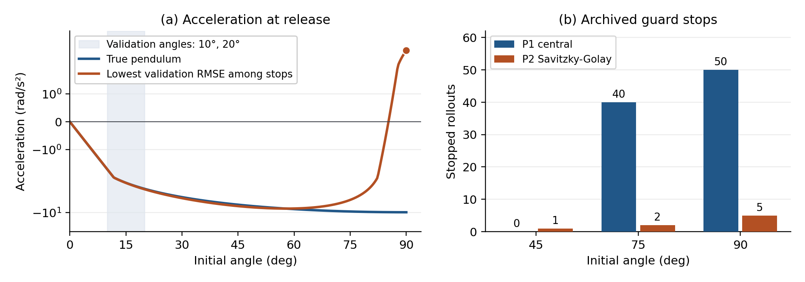

# Phase 4: Failure diagnostics for the frozen SINDy models

## What was checked

This analysis uses the 244 coefficient records frozen in Phase 2, all 732 archived test statuses and the Phase 3 solver refinement. It does not fit or select models again. The input hashes in [failure_summary.json](../results/failure_diagnostics/failure_summary.json) match the earlier run manifests. The [diagnostic script](../scripts/run_failure_diagnostics.py) computes the fitted and true acceleration at each release, then replays the 98 archived state-limit cases with the original combined terminal event and both DOP853 tolerance settings. It saves the event time and state even when the stop precedes the first positive output time.

## Findings

| Diagnostic | Result |
| --- | --- |
| Same guard in both settings | 98/98 reached angular speed 100 rad/s before the angle guard at 2π rad |
| Stop times | Median 1.93 ms; 86/98 before the first 0.02 s output sample |
| Difference between settings | Largest absolute event-time difference 3.15e-10 s |
| Where the stops occurred | 45°: 1/244; 75°: 42/244; 90°: 55/244 |
| Stop counts by estimator | P1 central: 90/366; P2 Savitzky-Golay: 8/366 |
| Velocity coefficient among stops | 58 zero, 27 negative, 13 positive |
| Rest direction among stops | 90 inward, 8 outward |
| Median absolute fitted/true acceleration ratio at release | 6.30e3 for stopped rollouts; 3.28 for completed rollouts |

The exact reference energy law implies a maximum true speed no greater than sqrt(2k) = 4.43 rad/s for these releases from rest at 90° or less. The 100 rad/s guard is far outside the reference regime. Replaying the terminal event distinguishes a reproducible fitted-model excursion from an integration failure. The two settings are a numerical consistency check.

### Noise in derivatives and weakly separated terms

Independent angle noise of SD σ contributes acceleration noise with SD sqrt(6) σ / Δt² to the three-point second difference. At 2° and Δt = 0.02 s this is 213.76 rad/s². The saved Training B validation acceleration RMSE was 211.72 rad/s² for P1 and 1.17 rad/s² for P2. Both predictors and acceleration estimates depend on the same angle observations, so errors in the regression need not be independent.

At small angles, the rest acceleration starts as (c₁ + c₃)θ + (c₂ - c₃/6)θ³. Measurements there can constrain combinations of coefficients more strongly than the individual coefficients. In the noiseless direct design, the RMS-scaled condition numbers were 51,647 for Training A and 3,100 for Training B. Validation at 10° and 20° probes only that small-angle region. The guard events concentrate at angles that extrapolate beyond either training set. Training B adds a trajectory and extends coverage, so this comparison does not isolate the effect of coverage.

### Two frozen examples

- **Lowest validation error among models with a stop:** `trial025_B_savgol` (2° noise, Training B, P2, seed 4) scored 0.04074 rad on validation, rank 13 of 20 within its condition by increasing error. At 90° its release acceleration is +4.08 rad/s², whereas the true acceleration is -9.81 rad/s². It hits +100 rad/s after 0.490 s with no velocity term. The linear and sine coefficients (-326.94 and +317.24) partly cancel near the origin, and the fitted rest force reverses sign by 90°.
- **Largest opposing linear and sine coefficients among stopped models:** `trial057_A_direct` (5° noise, Training A, P1, seed 16) has c₁ ≈ +3.52e6 and c₃ ≈ -3.52e6. It starts inward at 75° but at about -8.34e4 rad/s², and hits -100 rad/s after 1.32 ms. Its velocity coefficient is negative. Correct release direction and fitted dissipation can therefore coexist with grossly wrong restoring acceleration.

Of the completed rollouts, 39 also started outward. Release direction is a diagnostic, not a sufficient rule for predicting whether a guard is reached. The Phase 3 Lean theorem gives the fitted energy rate c₄ω²; a positive c₄ adds fitted energy, while the position-dependent field can be wrong even when that rate is zero or negative. These observations explain concrete failure cases and describe associations across the frozen sample.



## Files and reproduction

| Artifact | Contents |
| --- | --- |
| [release_diagnostics.csv](../results/failure_diagnostics/release_diagnostics.csv) | All 732 cases, exact identifiers, fitted coefficients, rest accelerations, and coefficient combinations |
| [guard_replays.csv](../results/failure_diagnostics/guard_replays.csv) | 98 cases with event time, state and trigger for both integrations |
| [failure_by_condition.csv](../results/failure_diagnostics/failure_by_condition.csv) | Counts by noise, training, estimator and initial angle |
| [failure_summary.json](../results/failure_diagnostics/failure_summary.json) | Counts, deterministic example selection, settings and source hashes |
| [SHA256SUMS](../results/failure_diagnostics/SHA256SUMS) | Hashes of diagnostics and figure |

From the project root, using the existing Python environment:

```bash
python3 -B scripts/run_isolated.py -- .venv/bin/python scripts/run_failure_diagnostics.py --output results/failure_reproduction --figures figures/failure_reproduction
sha256sum -c results/failure_diagnostics/SHA256SUMS
```

See the [Phase 4 report](../report/research_report.md) for the integrated results, [Phase 2](phase2_results.md) for the full fit and test analysis, and [Phase 3](phase3_results.md) for exact energy theorems and numerical drift.
