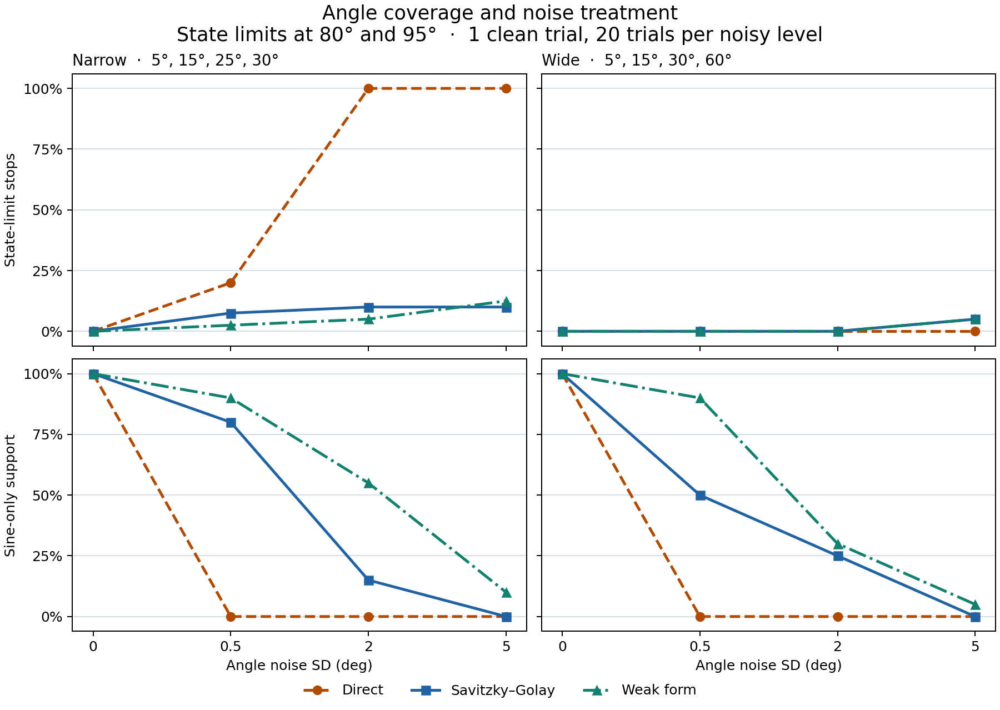
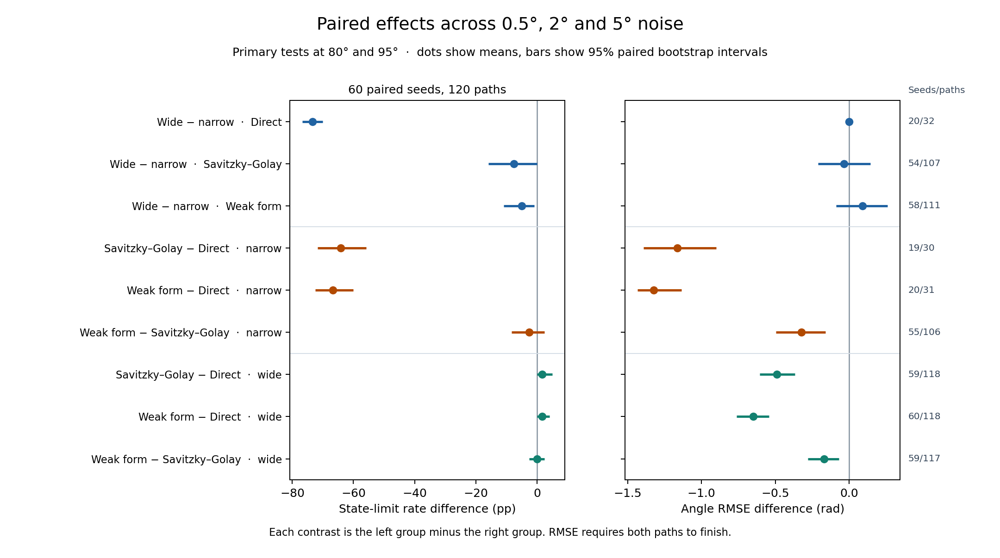
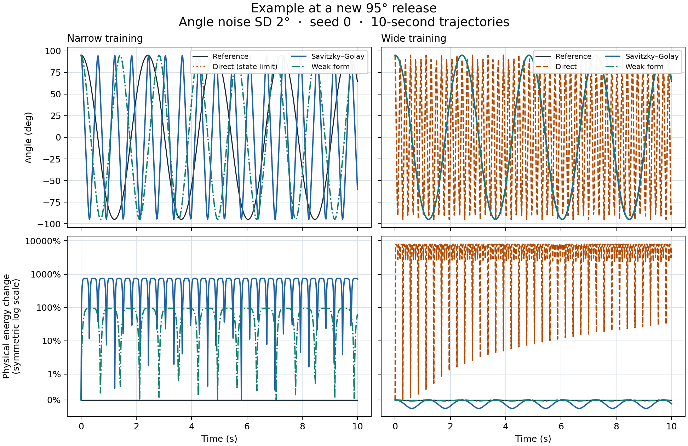

# Phase 5 results

## Benchmark

The narrow releases were 5°, 15°, 25° and 30°. The wide releases were 5°, 15°, 30° and 60°. Every method used the same two validation releases and matched noisy observations. The new test releases were 50°, 80° and 95°, with 80° and 95° outside both training ranges. Model selection was frozen before the test references were generated.

All 366 model cases selected a candidate. Of 1,098 planned tests, 986 completed and 112 stopped at the state limit of 2π rad or 100 rad/s. The primary releases accounted for 621 completions and 111 stops across 732 tests. The 50° secondary release accounted for 365 completions and one stop. [Frozen selection](results/main/selection_frozen.json) · [Test records](results/main/test_metrics.csv)

## Primary outcomes

The table pools noise standard deviations of 0.5°, 2° and 5°. Each row contains 60 fitted models and 120 intended tests at 80° and 95°. Error and energy medians use completed paths. Energy deviation is the largest absolute sampled difference from initial physical energy, divided by that initial energy.

| Training | Method | State-limit stops | Sine-only models | Median angle RMSE | Median maximum energy deviation |
| --- | --- | ---: | ---: | ---: | ---: |
| Narrow | Direct differences | 88/120 | 0/60 | 1.347 rad | 21,746% |
| Narrow | Savitzky–Golay | 11/120 | 19/60 | 1.350 rad | 408% |
| Narrow | Weak form | 8/120 | 31/60 | 0.034 rad | 0.400% |
| Wide | Direct differences | 0/120 | 0/60 | 1.376 rad | 3,924% |
| Wide | Savitzky–Golay | 2/120 | 15/60 | 1.132 rad | 6.35% |
| Wide | Weak form | 2/120 | 25/60 | 0.730 rad | 4.12% |

The methods recovered sine-only support in the clean trial under both designs. At 0.5° noise, the weak method recovered it in 18/20 fits per design. At 5° noise, it recovered it in 2/20 narrow and 1/20 wide fits. Direct differences recovered the support in zero noisy fits. [All noise levels](results/main/group_summary.csv) · [Per-release table](results/main/by_release.csv)

## Paired comparisons

The guard-rate comparisons use all 120 primary tests per group at positive noise levels. The RMSE comparisons use matching tests that completed in both groups and first average the differences within each seed. Brackets give 95% percentile intervals from paired bootstrap resampling stratified by noise level. The intervals describe uncertainty over the simulated noise draws.

| Contrast | State-limit rate difference (pp) | Paired angle RMSE difference (rad) | RMSE seeds / paths |
| --- | ---: | ---: | ---: |
| Wide − narrow, direct differences | −73.3 [−76.7, −70.0] | +0.0002 [−0.015, +0.017] | 20 / 32 |
| Wide − narrow, Savitzky–Golay | −7.5 [−15.8, 0.0] | −0.035 [−0.211, +0.146] | 54 / 107 |
| Wide − narrow, weak form | −5.0 [−10.8, −0.8] | +0.092 [−0.088, +0.260] | 58 / 111 |
| Weak form − Savitzky–Golay, narrow | −2.5 [−8.3, +2.5] | −0.325 [−0.494, −0.160] | 55 / 106 |
| Weak form − Savitzky–Golay, wide | 0.0 [−2.5, +2.5] | −0.170 [−0.281, −0.070] | 59 / 117 |

Wider training reduced stops for all three methods in this comparison. Every paired wide-minus-narrow RMSE interval included zero. For direct differences, all 32 matched completions came from the 0.5° condition because the narrow models stopped on every primary test at 2° and 5°. The paired RMSE estimate therefore describes a subset with lower noise. For the weak versus Savitzky–Golay comparisons, the RMSE intervals were below zero in both designs and the stop-rate intervals included zero. [All contrasts and denominators](results/main/paired_contrasts.csv)

## Physical interpretation

All 120 wide-design noisy primary tests completed, yet the median maximum deviation of physical energy was 39.24 times the initial physical energy. In the fixed 95° example at 2° noise and seed 0, the wide direct fit completes with a much shorter period than the reference. The energy panels share a symmetric logarithmic scale with a linear region within ±1% so that both small and large deviations are visible. [Saved path index](results/main/test_metrics.csv)

In the clean trial, the direct-difference library's RMS-scaled condition number fell from about 49,446 to 3,100 after replacing 25° with 60°. At small angles, θ and sin θ are nearly proportional, so a small validation rollout can fit several coefficient combinations. The weak method transfers time derivatives from the measured series to the test function. The sampled nonlinear features can still be biased by noise, and support recovery remained low at 5°. [Fit diagnostics](results/main/selected_models.csv)

For coefficients a, b, c and d on θ, θ³, sin θ and ω, respectively, the v1 Lean theorem gives the physical energy derivative ω[aθ + bθ³ + (c + k) sin θ + dω]. It proves that this derivative vanishes at every state exactly when a, b and d are zero and c = −k. A sine-only fit can therefore have a coefficient error and nonzero physical energy deviation. [Lean energy theorem](../lean/Pendulum/Energy.lean)

All 732 primary tests were repeated at tighter numerical tolerances. Every status was reproduced. For the 621 paths that completed at both tolerances, the largest change in angle RMSE was 4.17 × 10⁻¹⁰ rad and the largest change in the reported relative energy deviation was 1.51 × 10⁻⁷. The three reference paths had relative energy deviations below 3.42 × 10⁻¹¹. [Tolerance audit](results/main/tolerance_audit.csv) · [Verification record](results/main/verification.json)

The findings apply to a simulated undamped pendulum with known release conditions, independent Gaussian angle noise and the specified pair of training designs. Validation at 10° and 20° tests small-angle prediction. Performance on other angle designs, sensor noise and physical apparatus requires separate measurement.
