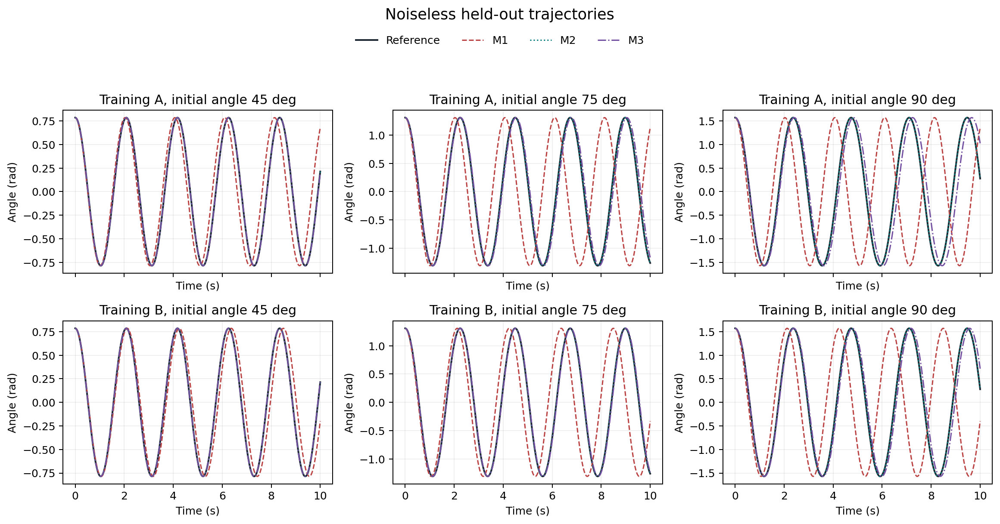
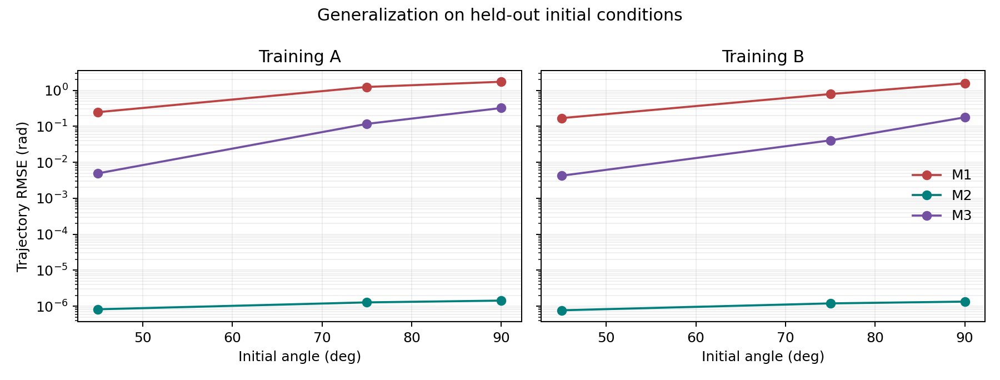
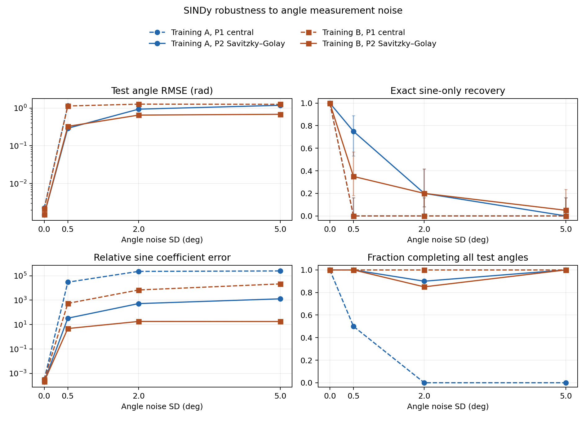
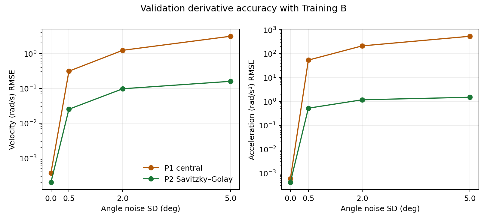
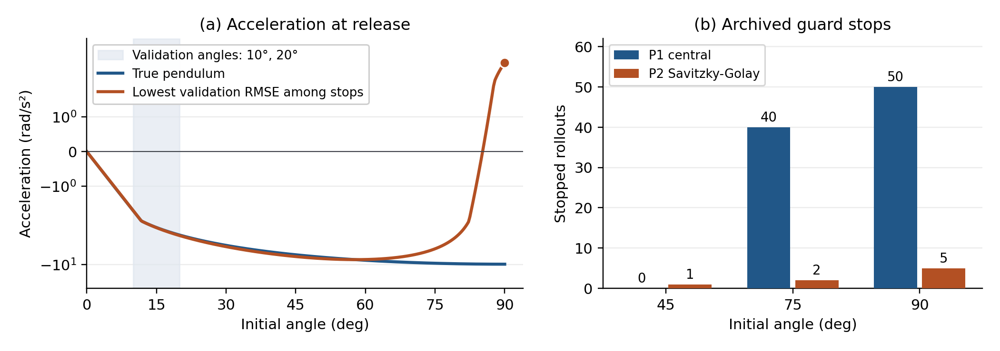
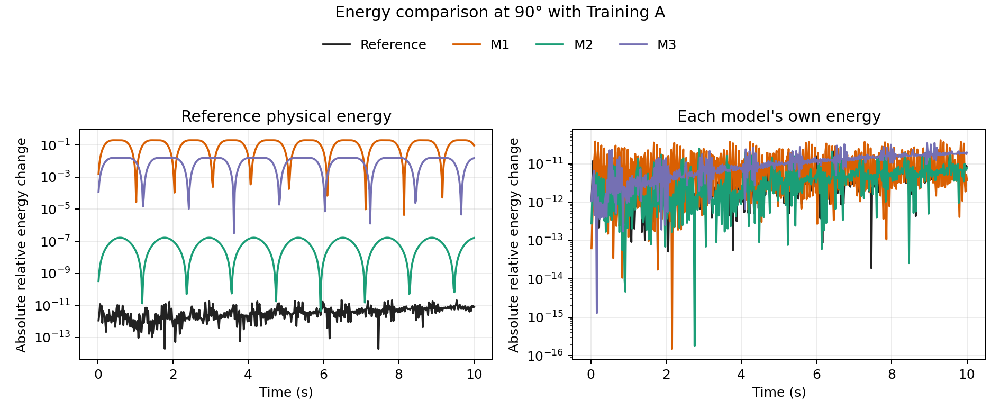
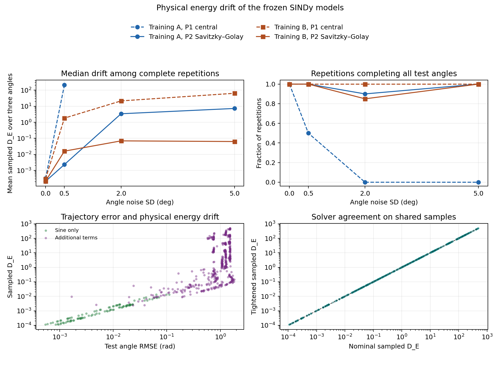

# Learning Nonlinear Pendulum Dynamics from Noisy Data

### Model generalization and formal verification in Lean 4

> **Abstract.** Can dynamics learned from noisy angles predict unseen motion and respect a physical law? In a synthetic pendulum, Savitzky-Golay preprocessing recovered sine-only support in 31 of 120 noisy fits, compared with 0 of 120 using central differences. Of 732 held-out rollouts, 98 reached the speed guard. Lean 4 proves the physical energy rate, interval conservation for the true dynamics and an all-state coefficient criterion. Energy and guard diagnostics expose extrapolation failures that small-angle validation can miss.

## 1. Introduction

We compare generalization across training amplitudes and ask what an exact energy theorem can certify about a learned equation. Sparse identification of nonlinear dynamics (SINDy) selects terms from a prescribed library [1]. Here that library already includes sine.

## 2. Physical model

For an undamped, unforced pendulum of length L = 1 m, let θ be the angle in radians, ω the angular velocity and k = g/L = 9.81 s⁻². The dynamics and energy per unit moment of inertia are

> dθ/dt = ω,    dω/dt = -k sin θ,    E(θ, ω) = ω²/2 + k(1 - cos θ).

Releases from rest run for 10 s at Δt = 0.02 s. Reference DOP853 integrations [3] have maximum relative energy drift 4.88e-11 and maximum period error 1.52e-12 s against the elliptic-integral benchmark [4].

## 3. Methodology

| Split | Initial angles | Role |
| --- | --- | --- |
| Training A | 5°, 15°, 30° | Fit coefficients from angle observations |
| Training B | A plus 60° | Broader coverage and one extra trajectory |
| Validation | 10°, 20° | Select noisy SINDy settings |
| Test | 45°, 75°, 90° | Evaluate frozen equations |

Phase 1 fits linear, sine and cubic baselines using five-point acceleration estimates. Phase 2 adds Gaussian angle noise (SD 0, 0.5°, 2°, 5°; 1, 20, 20, 20 repetitions). At each seed the methods share noise on common trajectories. P1 uses central differences; P2 uses Savitzky-Golay smoothing and differentiation [2].

We fix dθ/dt = ω and fit f = c₁θ + c₂θ³ + c₃ sin θ + c₄ω. RMS-scaled sequential thresholded least squares selects terms, followed by an unregularized refit. Validation rollout RMSE chooses thresholds and smoothing. All 244 fits were frozen before test reference generation.

<!-- page -->
## 4. Experimental results: noiseless baselines

<!-- figure-width: 462 -->

*Figure 1. Held-out nonlinear pendulum trajectories and candidate rollouts. The linear model accumulates phase error as the release angle increases.*

<!-- figure-width: 424 -->

*Figure 2. Held-out angle RMSE by initial amplitude. The supplied sine family transfers across all three angles.*

### Table 1. Learned baseline equations
<!-- table-widths: 0.65, 1.60, 1.45, 1.45 -->
| Model | Acceleration | Training A: a, b | Training B: a, b |
| --- | --- | --- | --- |
| M1 | -aθ | 9.535494, n/a | 8.755092, n/a |
| M2 | -a sin θ | 9.809998365, n/a | 9.809998467, n/a |
| M3 | -aθ - bθ³ | 9.808790, -1.610215 | 9.792631, -1.539308 |

### Table 2. Clean test performance (Training A / B)
<!-- table-widths: 0.60, 1.50, 1.60, 1.85 -->
| Model | Angle RMSE (rad) | Relative period error | Relative parameter error |
| --- | --- | --- | --- |
| M1 | 1.073 / 0.842 | 0.0863 / 0.0583 | n/a |
| M2 | 1.18e-6 / 1.10e-6 | 8.33e-8 / 7.81e-8 | 1.67e-7 / 1.56e-7 |
| M3 | 0.148 / 0.0741 | 0.00922 / 0.00454 | n/a |

Table 2 averages the three test angles. Periods use descending zero crossings. The reference k is comparable with a only in M2. M2's small error shows parameter recovery within the given sine family. Adding the 60° trajectory improves M1 and M3 test error in this design, which changes both coverage and sample count.

<!-- page -->
## 4. Experimental results: noisy identification

Across 61 noise and seed combinations, two training sets and two preprocessing methods, 9,760 candidate settings yielded 244 frozen equations. All four noiseless SINDy fits selected only the sine term. For the noisy fits, exact sine-only support was recovered in **0/120 with P1** and **31/120 with P2**. A sine term was present in every noisy fit, often with other terms. Correct support and a small coefficient error are separate outcomes.

*Figure 3. The upper-left RMSE uses seeds completing all three tests. Support intervals at positive noise are 95% Wilson intervals. Sine coefficient error uses models retaining the sine term.*

### Training B: performance on noisy observations
<!-- table-widths: 0.85, 1.45, 1.45, 1.15 -->
| Angle noise SD | P1 RMSE (rad) | P2 RMSE (rad) | Complete seeds P1 / P2 |
| --- | --- | --- | --- |
| 0.5° | 1.132 ± 0.090 | 0.327 ± 0.316 | 20 / 20 of 20 |
| 2° | 1.267 ± 0.014 | 0.650 ± 0.372 | 20 / 17 of 20 |
| 5° | 1.255 ± 0.032 | 0.683 ± 0.272 | 20 / 20 of 20 |

Values are seed means ± sample SD. At 5°, the paired P2 minus P1 difference was -0.572 ± 0.289 rad across all 20 pairs, with sine-only support in just one P2 fit. Smoothing improved prediction in this condition without reliably recovering the physical structure. At 2°, the P2 mean is conditional on 17 complete seeds; the complete-pair difference was -0.617 rad. For Training A with P1, no seed at 2° or 5° completed all three tests.

Overall, 634 of 732 rollouts completed; 595 completed rollouts yielded a period estimate. Finishing the rollout is a separate outcome from having small prediction error.

<!-- page -->
## 4. Experimental results: why the models failed

**Noise in the acceleration target.** With independent angle errors of SD σ, the stencil [1, -2, 1] / Δt² contributes acceleration noise with SD √6 σ / Δt². At 2° this predicts 213.76 rad/s². In Training B the observed mean validation acceleration RMSE was 211.72 rad/s² for P1 and 1.17 rad/s² for P2. Noise also enters the regressors, so accurate support is not ensured by smoothing alone.

<!-- figure-width: 430 -->

*Figure 4. Training B derivative RMSE against the clean validation reference. Points average validation angles within seeds, then average over seeds.*

**Weak separation of library terms.** Near zero, the leading terms in f(θ, 0) are (c₁ + c₃)θ + (c₂ - c₃/6)θ³. A small-angle fit can constrain these combinations while permitting large individual coefficients. In noiseless P1 the θ/sin θ correlation was 0.999885 (A) and 0.997906 (B); RMS-scaled condition numbers were 5.16e4 and 3.10e3. The refit can amplify errors along weakly constrained directions.

<!-- figure-width: 465 -->

*Figure 5. Left: the lowest validation RMSE among stopped models and the physical reference. The dot is its failed release. Right: archived state-limit stops.*

**Extrapolation in the fitted field.** The example in Fig. 5 (2°, B, P2, seed 4) has validation RMSE 0.0407 rad. Its coefficients (-326.94, 51.71, 317.24, 0) give +4.08 rad/s² at 90° and rest, versus -9.81 physically. It reaches |ω| = 100 rad/s at 0.490 s. A second fit (5°, A, P1, seed 16) has opposing linear and sine coefficients near ±3.52e6. At 75° it accelerates inward at -8.34e4 rad/s² and hits the same guard in 1.32 ms.

Both solver settings reproduce all 98 speed stops. Of these, 97 start at 75° or 90°, 86 stop before 0.02 s and 85 have zero or negative velocity coefficients. Thus severe acceleration errors can occur without fitted energy injection.

<!-- page -->
## 5. Formal verification

For real-valued differentiable trajectories with dθ/dt = ω and dω/dt = f(θ, ω), the chain rule gives the exact instantaneous law:

> dE/dt = ω[f(θ, ω) + k sin θ].

For the true pendulum f = -k sin θ the two terms cancel. Lean uses the mean value theorem [5] to prove constancy between any two times on a closed interval, assuming the states are continuous there and obey the derivative hypotheses in the interior. For the SINDy family the rate is

> dE/dt = ω[c₁θ + c₂θ³ + (c₃ + k) sin θ + c₄ω].

The fitted model's own energy has rate c₄ω². The physical rate vanishes for every state exactly when (c₁, c₂, c₃, c₄) = (0, 0, -k, 0). The archived decimals were encoded as exact rationals for the indexed theorem at k = 981/100. Exact coefficient comparison found no match among the 244 fits.

### Table 3. Verified Lean results
<!-- table-widths: 2.65, 2.32, 0.63 -->
| Lean theorem or family | Mathematical statement | Status |
| --- | --- | --- |
| physicalEnergy_hasDerivAt | General physical energy rate | Pass |
| linear_physicalEnergy_hasDerivAt; sinusoidal_physicalEnergy_hasDerivAt | Linear and sine-only rates | Pass |
| truePendulum_physicalEnergy_hasDerivAt_zero; truePendulum_physicalEnergy_eq_on_Icc | Ideal zero rate and interval constancy | Pass |
| linearEnergy_hasDerivAt_zero; linearEnergy_eq_on_Icc | Linear model's own conservation | Pass |
| polynomialEnergy_hasDerivAt_zero | Cubic model's own zero rate | Pass |
| sindy_physicalEnergy_hasDerivAt; sindy_modelEnergy_hasDerivAt | Exact physical and fitted energy rates | Pass |
| sindyPhysicalRate_zero_everywhere_iff | All-state coefficient criterion | Pass |
| FrozenModels: coefficient_count; physicalEnergy_hasDerivAt_for_model | Count and rate at each frozen index | Pass |

Lean 4.24.0 and pinned Mathlib revision f897ebc compiled the proof modules. The 13-theorem audit found only standard Lean axioms; no project axioms or unfinished proofs were used.

*Figure 6. At 90°, M1's own energy changes by 4.16e-11 of its initial value, while its physical energy varies by 20.0%. The exact linear theorem explains the first result; the quadratic and cosine potentials differ.*

<!-- page -->
## 6. Discussion and conclusion

We measure physical drift as D_E = max |E(t) - E(0)| / E(0) over the saved sample times, with k fixed to 9.81 s⁻². Among completed rollouts, the median was **0.099% for 105 sine-only cases** and **242% for 529 cases with additional terms**. This comparison is descriptive and conditional on completion.

<!-- figure-width: 440 -->

*Figure 7. Top left shows the median across seeds of the mean drift over the three test angles. Bottom right compares solvers on the same time grid.*

**Numerical checks.** All 634 completed pairs passed the same-grid comparison with tighter DOP853 tolerances. On the 0.01 s grid, one high-noise drift rose from 142.66 to 149.35. Sampled drift does not certify a continuous-time maximum.

**Scope and next steps.** Lean certifies implications for exact trajectories satisfying the specified dynamics. Neither small sampled drift nor preservation of a fitted energy determines physical accuracy. The study uses synthetic data, independent Gaussian angle noise and releases from rest. Training B increases both coverage and sample count. A follow-up could match training counts, broaden validation amplitudes, and compare integral identification and energy constraints.

**Reproducibility.** The [README](../README.md) gives replay commands. The [failure audit](../docs/phase4_failure_analysis.md) links to every guard event; the repository also includes frozen coefficients and Lean build records.

### References

[1] Brunton, S. L., Proctor, J. L., and Kutz, J. N. (2016). Discovering governing equations from data by sparse identification of nonlinear dynamical systems. *PNAS*, 113, 3932-3937. [DOI](https://doi.org/10.1073/pnas.1517384113).

[2] Savitzky, A., and Golay, M. J. E. (1964). Smoothing and differentiation of data by simplified least squares procedures. *Analytical Chemistry*, 36, 1627-1639. [DOI](https://doi.org/10.1021/ac60214a047).

[3] SciPy 1.15.3 documentation. [solve_ivp: DOP853 and event handling](https://docs.scipy.org/doc/scipy-1.15.3/reference/generated/scipy.integrate.solve_ivp.html).

[4] NIST Digital Library of Mathematical Functions. [22.19(i), Classical Dynamics: The Pendulum](https://dlmf.nist.gov/22.19.i).

[5] Mathlib. [Derivative mean value theorems](https://leanprover-community.github.io/mathlib4_docs/Mathlib/Analysis/Calculus/Deriv/MeanValue.html), used at revision f897ebc.
